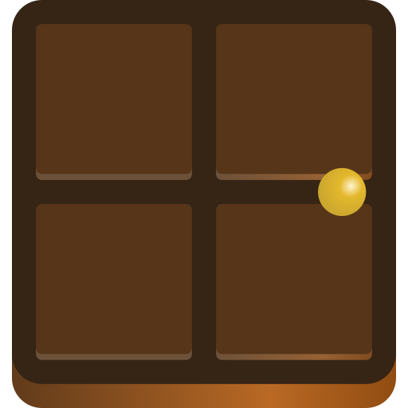
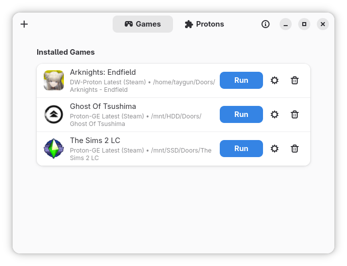
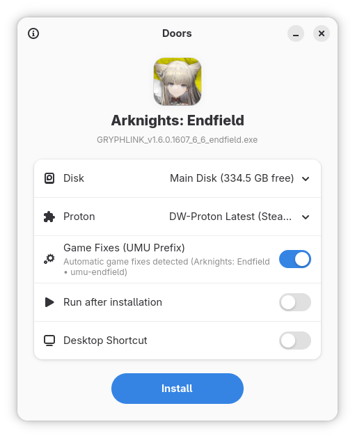
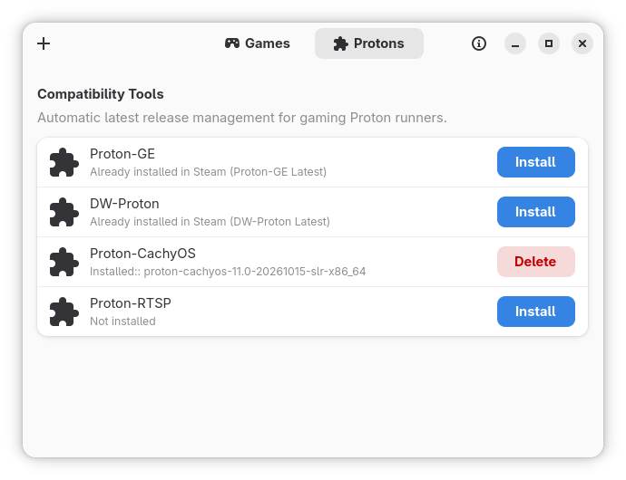
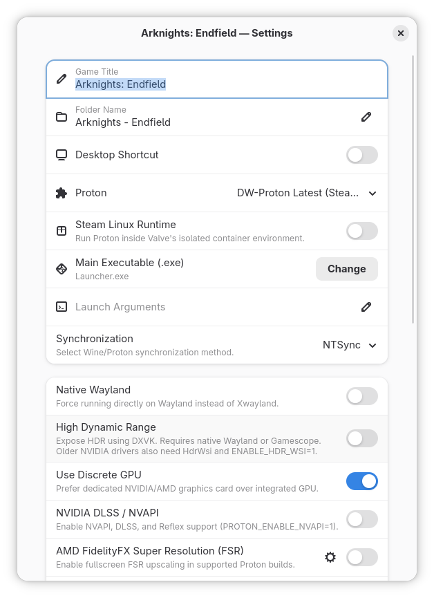

<div align="center">
  
  <h1>Doors</h1>
  <p><b>A fast, minimal GTK4 / Libadwaita Windows (<code>.exe</code> / <code>.msi</code>) game installer and runner for Linux powered by Proton.</b></p>
</div>

---

## Overview

**Doors** (`io.github.Taygun86.Doors`) lets you double-click any Windows `.exe` or `.msi` game installer, standalone executable, or portable folder in your Linux file manager, choose a target disk and a Proton version, and click **Install**. Doors automatically creates an isolated Proton prefix (`pfx`), applies automatic **UMU** game fixes, extracts embedded `.exe` metadata and high-resolution icons, and adds a native application shortcut (`.desktop`) to your desktop environment's game menu.

---

## Screenshots

<div align="center">
  <table>
    <tr>
      <td align="center" width="50%">
        <br />
        <sub><b>Installed Games Library</b></sub>
      </td>
      <td align="center" width="50%">
        <br />
        <sub><b>One-Click Install Wizard &amp; UMU Fixes</b></sub>
      </td>
    </tr>
    <tr>
      <td align="center" width="50%">
        <br />
        <sub><b>Built-in Proton Compatibility Tools Manager</b></sub>
      </td>
      <td align="center" width="50%">
        <br />
        <sub><b>Per-Game Proton, Display &amp; Performance Settings</b></sub>
      </td>
    </tr>
  </table>
</div>

---

## Built-in Proton Manager & Steam Discovery

Doors includes a **built-in Compatibility Tools manager** that lets you download, manage, and automatically update **Proton-GE**, **Proton-CachyOS**, and **Proton-EM** directly from the app (`~/.local/share/doors/compatibilitytools.d`), complete with a background `systemd --user` auto-updater for Latest channels and the UMU database.

In addition to its own runners, Doors automatically discovers existing Proton tools and **Steam Linux Runtime (`sniper`)** installed via **Steam**:

- `~/.local/share/doors/compatibilitytools.d` (Doors built-in Proton manager)
- `~/.local/share/Steam` / `~/.steam/root` / `~/.steam/debian-installation` (`compatibilitytools.d` & `steamapps/common`)
- `~/.var/app/com.valvesoftware.Steam/data/Steam` (Flatpak Steam)
- `/usr/share/steam/compatibilitytools.d` & `/usr/local/share/steam/compatibilitytools.d`
- Secondary Steam libraries mounted under `/mnt/*`, `/var/mnt/*`, `/run/media/$USER/*`, and `/media/$USER/*`
- Custom paths via the `DOORS_COMPAT_TOOLS_PATH` environment variable (colon-separated)

---

## Features

- **Double-Click `.exe` / `.msi` Wizard:** Associate Windows executables and installers with Doors for a clean install wizard displaying the extracted game icon, embedded PE product name, target disk, Proton version, automatic **UMU Game Fixes** switch, desktop shortcut toggle, and *"Run after installation"* switch.
- **Smart Installer & Portable Folder Detection:**
  - **Portable / Pre-installed Folders:** Automatically detects when an `.exe` is inside a portable game directory, moves or links the folder into `<Disk>/Doors/<Game>/game/` (with byte-level cross-drive copy progress), and configures the prefix.
  - **Setup Installers (`setup.exe`, `*install*.exe`, `.msi`):** Runs the installer inside `<Disk>/Doors/<Game>/pfx`, waits for detached child setup processes via `wineserver`, and inspects Windows Desktop/Start Menu `.lnk` shortcuts and Wine Registry entries to bind the installed executable and preserve game-specific icons.
  - **Single Standalone `.exe`:** Runs standalone executables inside an isolated prefix and organizes single-file games into `<Disk>/Doors/<Game>/game/`.
- **Built-in Proton & UMU Manager:** Download Proton-GE, Proton-CachyOS, and Proton-EM directly inside Doors and automatically detect per-game `UMU_ID` fixes from the UMU database.
- **Multi-Disk Support:** Automatically detects your main disk (`~/Doors`) as well as secondary drives mounted under `/mnt/*`, `/var/mnt/*`, `/run/media/$USER/*`, and `/media/$USER/*` with available free space indicators.
- **Automatic Metadata, Icon & `.desktop` Shortcut Generation:** Parses PE `VS_VERSION_INFO` resources (`ProductName` / `FileDescription`) and `.lnk` shortcut icon locations directly to extract the highest-resolution icon and create native desktop shortcuts.
- **Per-Game Settings & Prefix Management:**
  - Switch Proton version, toggle **Steam Linux Runtime**, or toggle **UMU Game Fixes** at any time
  - Custom launch arguments / environment variables (supports `%command%`)
  - Manually change the target main `.exe` or rename the game title (updates `.desktop` shortcut instantly)
  - **Synchronization:** `NTSYNC` (auto-selected when `/dev/ntsync` is available), `FSYNC`, `ESYNC`, or Disabled
  - **Display & Graphics:** Native Wayland (`PROTON_ENABLE_WAYLAND=1`), HDR (`PROTON_ENABLE_HDR=1`), Discrete GPU offload (`DRI_PRIME=1` & NVIDIA Prime), NVIDIA DLSS / NVAPI (`PROTON_ENABLE_NVAPI=1`), AMD FSR 1.0 (`WINE_FULLSCREEN_FSR=1`), AMD FSR 4 (`PROTON_FSR4_UPGRADE=1` on supported RDNA GPUs), Ray Tracing (`DXR`), DXVK Async (`DXVK_ASYNC=1`), and **vkBasalt**
  - **Performance & Overlay:** **Feral GameMode** (auto-enabled if installed), **MangoHud**, **DXVK HUD**, and **Gamescope** (with custom resolution, FPS limit, and fullscreen controls)
  - **Prefix Tools:** Open game/prefix folder, run an installer/patch/update `.exe` inside the prefix, open `winecfg` or `Winetricks`, or **Reset Prefix** (`pfx`) without deleting game files.
- **Multilingual UI:** English default in source code with built-in translations for 25 additional languages (`tr`, `de`, `fr`, `es`, `it`, `pt`, `ru`, `uk`, `pl`, `nl`, `cs`, `hu`, `ro`, `el`, `sv`, `az`, `kk`, `ar`, `fa`, `hi`, `id`, `vi`, `ja`, `ko`, `zh`).

---

## Building & Installation

### Dependencies

Make sure you have the Rust toolchain (`cargo`, `rustc`), `gettext` (`msgfmt`), and the development packages for **GTK4** and **Libadwaita** installed:

- **Fedora:**
  ```bash
  sudo dnf install cargo rust gtk4-devel libadwaita-devel gettext
  ```
- **Ubuntu / Debian:**
  ```bash
  sudo apt install cargo rustc libgtk-4-dev libadwaita-1-dev gettext
  ```
- **Arch Linux:**
  ```bash
  sudo pacman -S rust gtk4 libadwaita gettext
  ```

### System / User Installation

Run the included install script to build the release binary and install the desktop entry, icons, MIME associations, and locale files:

```bash
./install.sh
```

To uninstall:

```bash
./uninstall.sh
```

### Flatpak (Taygun86 Repository)

Make sure Flathub is enabled (for the `org.gnome.Platform` runtime), then add the **Taygun86** Flatpak repository:

```bash
flatpak remote-add --if-not-exists flathub https://dl.flathub.org/repo/flathub.flatpakrepo
flatpak remote-add --if-not-exists taygun86 https://taygun86.github.io/taygun86-repo/flatpak/taygun86.flatpakrepo
flatpak install taygun86 io.github.Taygun86.Doors
```

### Local Flatpak Build

Build and install locally using `flatpak-builder` ([`io.github.Taygun86.Doors.yml`](io.github.Taygun86.Doors.yml)):

```bash
flatpak-builder --user --install --force-clean build-dir io.github.Taygun86.Doors.yml
```

---

## License

This project is licensed under the **GNU General Public License v3.0 or later (GPL-3.0-or-later)** — see the [LICENSE](LICENSE) file for details.


